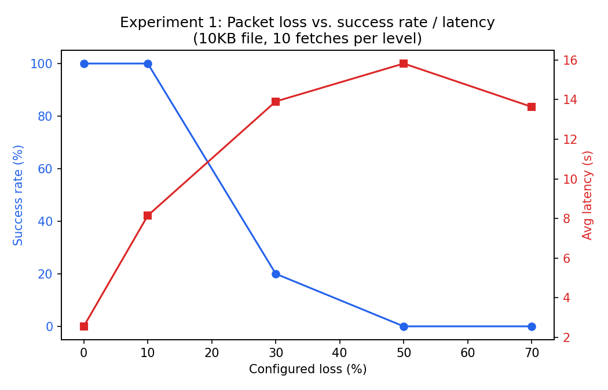
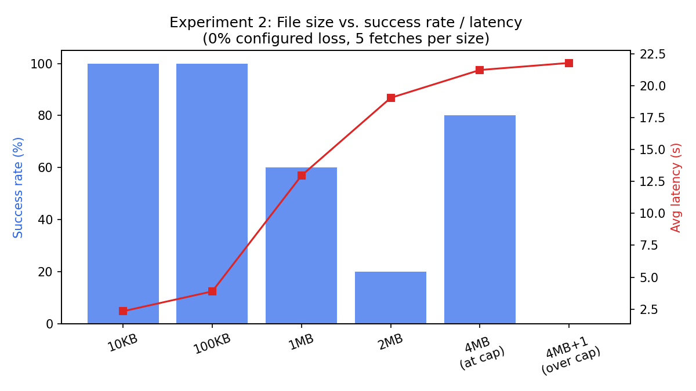
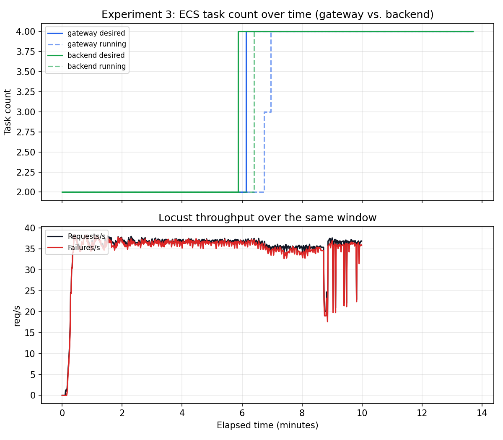

# Midterm Mastery Part 2 — Study Report
### Experimental evaluation of `file-transfer-playservice`

This is a self-contained study document summarizing everything done for
this assignment: what the service is, how each experiment was run, what
the data actually showed, and why it matters. It's meant to be read on
its own — all the deeper raw evidence it references lives in
`../screenshots/` and the experiment folders under `../experiments/`.

---

## 1. The service, architecture, and why it's interesting to test

`file-transfer-playservice` is a small distributed file-transfer system
with two independently-deployed components:

- **Gateway** — an HTTP service (Go, Gin) sitting behind an **Application
  Load Balancer (ALB)**. It accepts `GET /files?name=X` from the outside
  world.
- **Backend** — a UDP service sitting behind an **internal Network Load
  Balancer (NLB)**. It reads files from S3, chunks them into 64-byte
  pieces, and streams them to whoever asked over a custom protocol called
  **FTP_6650**.

When a request comes in, the gateway acts as the **UDP client**: it sends
an `OPEN <filename>` datagram to the backend, receives a stream of
numbered chunk datagrams back, and if any chunks are missing after a
timeout, sends `RETY <filename> <chunk-id>` for each one — up to **5
rounds** of retry, and up to **5 attempts** at the initial `OPEN` if no
data comes back at all. If chunks are still missing after all of that, the
gateway gives up with an internal error (`ErrIncomplete`, logged as "gave
up with chunks still missing"), which surfaces to the original HTTP caller
as a `504`.

This two-tier, two-load-balancer-type design is what makes the service
interesting to evaluate: **the ALB and the NLB expose fundamentally
different metrics to Auto Scaling**, which is the whole premise of
Experiment 3. It's also a good target for failure-injection experiments
because loss and retries are first-class, configurable features of the
protocol itself (not something you have to simulate from outside).

Infrastructure: ECS Fargate (2 services, `gateway` and `backend`, each
auto-scaling between 2 and 4 tasks by default), managed with Terraform,
deployed to AWS Academy Learner Lab (`us-west-2`).

---

## 2. Experiment 1 — Packet loss vs. retry/success behavior

### What it set out to test
Sweep the backend's configurable `backend_send_loss` / `backend_recv_loss`
(percent of datagrams dropped in each direction, simulating a lossy
network) from 0% to 70%, and measure how the fixed 5-OPEN/5-RETY retry
budget holds up.

### A real discovery before the real experiment even started
The assignment's own suggested file size was 500KB. At **0% configured
loss**, fetching that file failed **100% of the time** (4/4 attempts,
HTTP `504` after ~16 seconds). That's a red flag — if the network isn't
dropping anything, nothing should fail.

CloudWatch backend logs explained why: `DEBUG: Overloaded: dropped
incoming datagram`. Looking at the backend's own code
(`transfer-server/protocol/server.go`), the `Serve()` function runs a
fixed pool of **8 workers** pulling jobs off a **32-slot buffered
channel**. When that channel is full, an incoming datagram is dropped
**non-blockingly** — by design, per the code's own comment: *"just as a
real network drops datagrams when overloaded; the client's timeout and
RETY logic cover it."*

The problem: a 500KB file is ~7,800 chunks. A single client fetching that
file generates enough of its own `RETY` traffic that it can saturate its
*own* 32-slot queue — with **zero actual network loss involved**. The
service's retry budget was tuned to tolerate real network loss, not
self-inflicted queueing overload from a single large transfer.

To confirm this wasn't a hard size cutoff but something probabilistic
(queue-state-dependent), a quick follow-up test fetched 20KB/30KB/50KB/
70KB files repeatedly: **30KB and 70KB succeeded while 50KB failed in
between** — a non-monotonic pattern that only makes sense if the failure
depends on the queue's momentary fullness, not strictly on file size. A
**10KB** file was confirmed reliable (5/5, then 10/10 later) and used as
this experiment's controlled size instead — isolating the *loss* variable
cleanly from the *overload* variable. Full evidence:
`../screenshots/overload-finding-raw-evidence.txt`.

### The actual loss sweep
10KB file, 10 fetches per loss level, loss applied symmetrically
(`backend_send_loss = backend_recv_loss`):

| Configured loss | Success rate | Avg latency |
|---|---|---|
| 0% | 10/10 (100%) | 2.55s |
| 10% | 10/10 (100%) | 8.15s |
| 30% | 2/10 (20%) | 13.91s |
| 50% | 0/10 (0%) | 15.83s |
| 70% | 0/10 (0%) | 13.64s |



### Reading the data
There's a **sharp reliability cliff between 10% and 30% loss**, not a
gradual decline. At 10% loss the retry budget absorbs everything (just
~3x the latency of the 0% case). By 30%, success collapses to 20%, and by
50%+ it's zero.

CloudWatch confirms the retry mechanism itself is working correctly, not
broken: **11,500+ `RETY`-tagged log lines** across the 30/50/70% levels
show individual per-chunk retries happening exactly as designed (sample:
`../screenshots/exp1-rety-log-sample.txt`). The failures at 30%+ loss are
a **budget-exhausted** retry loop, not a malfunctioning one — the client
simply runs out of its fixed 5 rounds before recovering all the chunks a
30%+ loss rate keeps destroying.

### Takeaway
This service has **two independent, additive sources of effective packet
loss**: real configured network loss, and self-inflicted queue-overload
drops from a large/bursty transfer. The documented "5 tries" retry budget
was clearly sized with the first one in mind — it comfortably handles
~10% real loss — but it isn't aware of the second. A large file at 0%
loss and a small file at ~15-20% loss can fail for the *same underlying
reason* (the queue), even though only one of them looks like a
"packet loss" problem from the outside.

---

## 3. Experiment 2 — File size vs. transfer time, and the 4MB cap

### What it set out to test
Fetch files of increasing size (10KB up to the protocol's hardcoded 4MB
cap, then one chunk over that cap) at **0% configured loss**, to isolate
the effect of size alone — and then make a real code change (raise the
cap) and see if it actually works end-to-end.

### The size sweep
0% loss, 5 fetches per size:

| File size | Success rate | Notes |
|---|---|---|
| 10KB | 5/5 (100%) | ~2.3s each |
| 100KB | 5/5 (100%) | 2.5s–9.2s |
| 1MB | 3/5 (60%) | one 504, one long-tail 200 (18.4s) |
| 2MB | 1/5 (20%) | mostly 504 |
| 4MB (at cap, 65,536 chunks) | 4/5 (80%) | |
| 4MB + 1 chunk (over cap) | 0/5 (0%) | every attempt 504 |



### Reading the data
At 0% configured loss, success should in principle be 100% regardless of
size — there's no size-dependent loss model in the protocol. Instead it
degrades sharply (100% → 60% → 20%) between 100KB and 2MB, for exactly the
same reason as Experiment 1's discovery: more chunks means more
self-inflicted `RETY` traffic hammering the fixed 32-slot queue. The
apparent *improvement* at 4MB-at-cap (80%) vs. 2MB (20%) isn't a
contradiction — it's more evidence that this is **probabilistic and
queue-state-dependent**, not a clean function of size.

The over-cap file (4MB + 1 chunk) failed **100% of the time**, but for a
completely different reason: the client enforces a hard `maxChunks =
65536` bounds check (`transfer-client/udp/udp-client.go`) and simply can't
accept a response describing more chunks than that. This surfaces as the
same `504` timeout as every other failure (no distinct error code), but
it's a *deliberate protocol limit*, not a performance cliff.

### The raise-cap patch: a real code change, and a second real finding
`raise_cap_patch/apply_raise_cap.sh` changes one line:
```go
const maxChunks = 65536   // 4 MiB   ->   131072  // 8 MiB
```
in `transfer-client/udp/udp-client.go` — then rebuilds the Go binary,
rebuilds the Docker image, pushes it to ECR, and redeploys via Terraform.
This was applied for real against the live deployment.

**Result: fetching an 8MB file through the patched gateway still failed
100% of the time** (5/5 attempts, `504`s, 44–56 second latency — even
longer than the loss-sweep failures). CloudWatch pinpointed exactly why,
and it required looking in the **right log group** — a correction worth
remembering: the `ErrIncomplete`/"Missing chunks, retrying" logging lives
in `transfer-client/udp/udp-client.go`, which runs **inside the gateway**
(the gateway plays the UDP client role), so that evidence is in
`/ecs/file-transfer-gateway`, not `/ecs/file-transfer-backend`. Once
looking in the right place:

- **Gateway logs:** all 5 attempts hit `gave up with chunks still
  missing` (`ErrIncomplete`) after exhausting the full 5-round retry
  budget — every single fetch.
- **Backend logs, same window:** **73,154** "Overloaded: dropped incoming
  datagram" lines — more than 6x the 11,500+ RETY-related lines from
  Experiment 1's *entire* loss sweep, generated by a single 8MB
  (131,072-chunk) fetch attempt.

Full evidence: `../screenshots/raise-cap-8mb-evidence.txt`.

### Takeaway
Raising `maxChunks` is a real, working, one-line change — the gateway
genuinely accepts and attempts to assemble the larger response, where the
unmodified client would have rejected it outright. But **the advertised
limit (`maxChunks`) and the service's actual reliability ceiling are two
different, independently-fixable problems.** The reliability ceiling is
set by the fixed worker-pool/retry-budget design documented in Experiment
1, and it sits well below 4MB for a single client already — raising the
cap to 8MB doesn't touch that at all. This is a nice, concrete example of
a common distributed-systems trap: a documented/advertised limit isn't
automatically the same thing as the limit you'll actually hit in practice.

---

## 4. Experiment 3 — ALB request-rate vs. NLB-forced-CPU scaling trigger

### What it set out to test
The gateway and backend scale on fundamentally different metric types,
because of the load balancer type each sits behind:

- **Gateway** scales on `ALBRequestCountPerTarget` — a real, direct,
  per-target request-rate metric that only an Application Load Balancer
  provides.
- **Backend** sits behind a Network Load Balancer, which has **no**
  equivalent per-target request metric — so it's forced onto
  `ECSServiceAverageCPUUtilization` instead, an aggregate, indirect proxy.

The natural hypothesis (and the premise the assignment points at): the
direct, per-target metric should react **faster and more reliably** than
the aggregate CPU proxy.

### Methodology
Lowered both scaling targets to make a clean, within-test-window scale-out
likely: `gateway_requests_per_target` 100 → 20 req/min/task,
`backend_cpu_target` 60% → 30% CPU. (Applied directly via `aws
application-autoscaling put-scaling-policy` — these are pure Application
Auto Scaling policy settings, not container config, so no rebuild was
needed.) Confirmed a clean 2/2 baseline for both services, then ran a
10-minute Locust load test — 200 users, ramping at 20/s, hitting
`GET /files` for a mix of 10KB/100KB/1MB files — while polling both
services' ECS desired/running task counts every 10 seconds.

(Along the way, found and fixed a real bug in the scaffold script
`deploy_with_lower_thresholds.sh`: its `REPO_ROOT` path used one `../`
too many for its actual directory depth, causing `scripts/deploy.sh: No
such file or directory`.)

### What happened under load
The 2-task baseline was overwhelmed almost immediately: **21,359 requests
over 10 minutes, 98.56% failures** (20,750 `503`s, 302 `504`s), median
latency 5.1 seconds. This is expected and useful — 200 concurrent users
against a demo-sized baseline is exactly the kind of load meant to force a
scaling decision.

### The scaling timeline


| Metric | Breached its target by | Actual scale-out (`desiredCount` 2→4) |
|---|---|---|
| Backend CPU (target 30%) | ~60s after load start — jumped to **52%** average, then sustained 52–74% for 5+ minutes | **T+5:52** |
| Gateway `RequestCountPerTarget` (target 20/min) | ~60s after load start — **~1,040–1,109 requests/min/target**, ~50x over target | **T+6:08** (16 seconds after backend) |

Raw CloudWatch datapoints behind this table are in
`../screenshots/exp3-scaling-raw-evidence.txt`. Both services hit their
configured ceiling (`max_capacity = 4`) and stayed there for the rest of
the test — neither had room to scale further in this configuration.

### The surprising part
Both metrics breached their configured targets **almost instantly**
(within about a minute of load starting) and by **enormous margins** — CPU
at roughly 1.7–2.5x its target, request count at roughly **50x** its
target. So the metrics themselves were never the bottleneck; both were
screaming "scale me" from minute one.

And yet the actual scale-out action didn't happen for **either** service
until **5.5–6 minutes** after that breach — and the two services ended up
only **16 seconds apart**, with the CPU-driven backend actually edging out
the request-rate-driven gateway.

This directly contradicts the naive expectation that a direct per-target
metric should meaningfully outpace an aggregate CPU proxy. What it points
to instead: the ~5.5–6 minute delay is dominated by **AWS Application Auto
Scaling's own target-tracking alarm mechanics** — which require a
sustained breach across multiple CloudWatch evaluation periods before
acting, specifically so a short traffic spike doesn't cause flapping — and
that mechanism applies almost identically regardless of which metric type
is feeding it.

### Takeaway
Auto scaling *worked*: both services correctly detected overload and
scaled to their configured max. But "the gateway's metric is more direct"
did not translate into "the gateway scales out meaningfully faster" in
practice. The fairer characterization of this service's actual scaling
behavior: expect roughly a **5–6 minute lag** between a real traffic spike
and any scaling response, regardless of which load balancer type sits in
front of a given service — the ALB-vs-NLB metric asymmetry mattered far
less than the scaler's own built-in reaction delay.

---

## 5. Cross-cutting themes (good material for Q&A / discussion)

1. **A fixed retry/timeout budget tuned for one failure mode doesn't
   automatically cover a different one.** Experiment 1's retry budget
   handles real network loss well, but is blind to self-inflicted
   queue-overload drops — which Experiments 1 and 2 both show can
   dominate at larger transfer sizes even with 0% configured loss.
2. **An advertised limit and the actual reliability ceiling are different
   things.** Experiment 2 showed the `maxChunks` cap is real and
   raising it works exactly as documented — but it doesn't move the
   actual point where transfers start failing, which is set by a
   completely different mechanism (the worker queue).
3. **A metric breaching its threshold and a system actually reacting to
   it are different events, separated by real, sometimes-large lag.**
   Experiment 3's ~5.5-6 minute gap between breach and action, for both
   metric types, is a good concrete number to remember: "the auto scaler
   noticed instantly" does not mean "the auto scaler acted instantly."
4. **Root-causing requires checking the right log group / the right
   component.** The raise-cap patch result only made sense after
   realizing the client-side retry logging lives in the *gateway's* logs,
   not the backend's, because the gateway plays the UDP client role in
   this architecture.
5. **Reading the actual queue/worker code mattered more than the
   assignment's own suggested parameters.** The most significant finding
   in this whole report (the queue-overload discovery) wasn't something
   any of the three experiments set out to measure — it turned up because
   the originally-suggested 500KB test file simply didn't work, and
   `server.go`'s `Serve()` function explained why.

---

## 6. Where everything lives

- Full narrative findings (slightly more detail than this report):
  `../README.md`
- Presentation talking points (4-5 min, same findings condensed):
  `../presentation/talking_points_outline.md`
- Raw data CSVs: `../experiments/exp1_packet_loss/loss_sweep_results.csv`,
  `../experiments/exp2_file_size/size_sweep_results.csv`,
  `../experiments/exp2_file_size/raise_cap_patch/raise_cap_results.csv`,
  `../experiments/exp3_scaling_metrics/scaling_timeline.csv` and
  `scaling-test_stats_history.csv`
- Raw log/evidence dumps: everything in `../screenshots/*.txt`
- Plots: `../screenshots/*.png`
